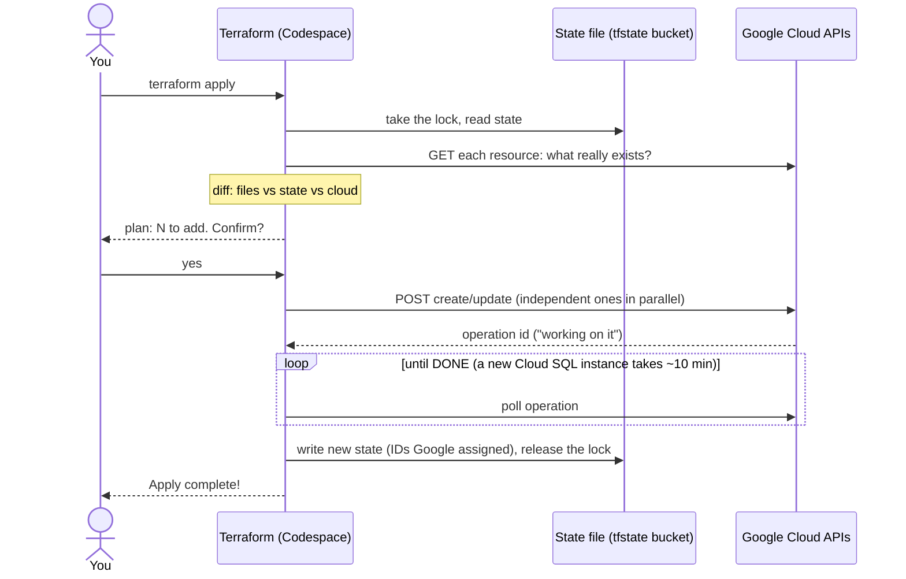
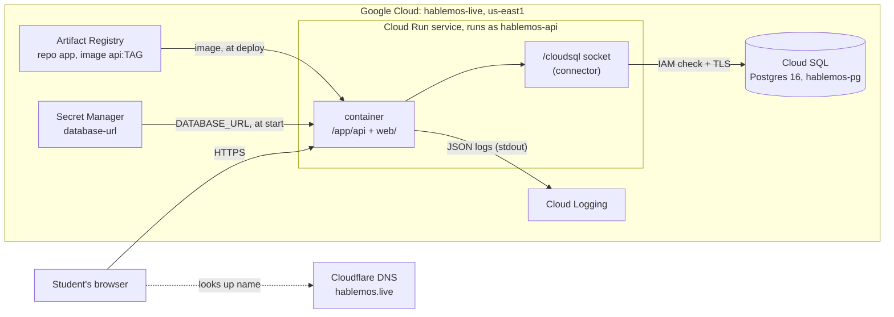
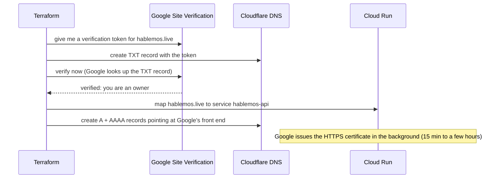
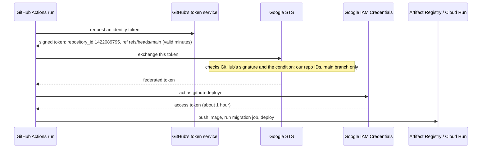
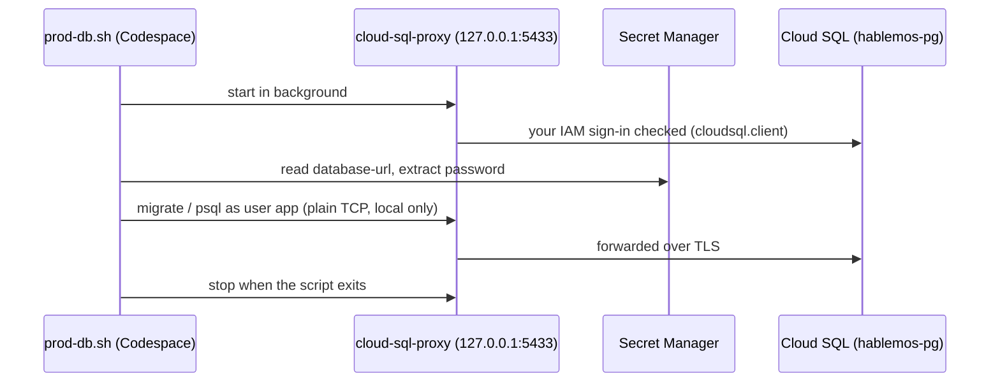

# How deployment works

The app runs in Google Cloud (project `hablemos-live`, region `us-east1`). Everything there
is described by the Terraform files in [`infra/`](../infra/), except the two things
[`infra/bootstrap.sh`](../infra/bootstrap.sh) creates first (two APIs and the state bucket).

## One `terraform apply`, call by call

Terraform runs in the Codespace and is just a client of Google's REST APIs, signed in as you
(`gcloud auth application-default login`). It never touches the app container.



`terraform plan` is the steps up to the plan only; it changes nothing. `docker push` follows the
same pattern with a different client: REST calls to Artifact Registry, signed in as you.

**Idempotent, not atomic.** Running `apply` again when nothing changed does nothing. But an
apply has no commit or rollback: if it fails halfway, what finished stays created and recorded,
and the next `apply` carries on from there. A single resource is mostly all-or-nothing, with
three exceptions:

- **Tainted**: Google created it but a follow-up step failed. The next plan proposes to replace it
  (deletion protection blocks that for the database, on purpose).
- **Orphaned**: Terraform was killed mid-apply, so Google finished creating something that never
  reached the state file. The next apply fails with "already exists"; fix with `terraform import`.
  So once an apply starts, let it finish (one Ctrl-C stops gracefully, a second one kills it).
- **Failed**: Google itself reports failure (e.g. a Cloud SQL instance in `FAILED`). Delete it and apply again.

The state lock (an object in the bucket) stops two applies from running at once.

## The running system

Once deployed, Terraform is out of the picture.



Until the domain is set up, the app is at a Google-made address. Cloud Run answers on two:
`https://hablemos-api-529979780991.us-east1.run.app` (the newer, predictable form:
service-projectnumber.region, used for `APP_BASE_URL` in `infra/run.tf`) and
`https://hablemos-api-bfox5zpazq-ue.a.run.app` (the older hashed form, which `terraform output
service_url` reports). Both reach the same service.

## Deploying a new version (by hand, until GitHub Actions)

```bash
cd /workspaces/language-classes
git status                                   # commit first: the tag is the commit
TAG=$(git rev-parse --short HEAD)
IMAGE=us-east1-docker.pkg.dev/hablemos-live/app/api:$TAG
docker build -t $IMAGE . && docker push $IMAGE
scripts/prod-db.sh migrate up                # only if there are new migrations
# edit infra/run.tf: local.image_tag = "<the TAG printed above>"
cd infra && terraform apply
curl -s "$(terraform output -raw service_url)/health"; echo   # expect {"status":"ok"}
```

Migrations go first, so the new code never runs against an old schema. Keep migrations
backward-compatible (add columns/tables; drop only in a later release), because the old
revision keeps serving until the new one is ready. Each apply creates a new Cloud Run
**revision**; the previous one stays available for rollback (set the old tag and apply again).

### Following one request

1. The browser sends `GET /sessions` over HTTPS. Google terminates TLS, so the Go server
   speaks plain HTTP on `$PORT`, the same as in the Codespace.
2. If no copy of the container is running (nobody visited for a while), Cloud Run starts one
   and that first request waits a second or two: a **cold start**, the price of paying nothing
   while idle.
3. The container already has `DATABASE_URL` in its environment. Cloud Run read it from
   Secret Manager, which it may do because the service runs as `hablemos-api`.
4. pgx opens the Unix socket `/cloudsql/hablemos-live:us-east1:hablemos-pg`. The connector
   behind it checks the service account's `roles/cloudsql.client`, opens TLS to Cloud SQL and
   passes the Postgres protocol through. That's why the database needs no allowed networks.
5. The query runs, JSON goes back, and the request log line (with its request ID) lands in
   Cloud Logging.

## Every piece

| Piece | What it is | Closest IBM i idea | Defined in |
|---|---|---|---|
| State file | Terraform's record of what it created, with Google's IDs | A catalog the next run compares against | `gs://hablemos-live-tfstate` |
| Service APIs | Switches that let the project use a product | Licensing a product option | `infra/main.tf` |
| Artifact Registry | Private Docker image store, repository `app` | The library you deploy program objects from | `infra/main.tf` |
| Service account | `hablemos-api`, the identity the app runs as | The user profile a job runs under, with only its own authorities | `infra/main.tf` |
| Cloud SQL | A Google-managed VM running Postgres 16, daily backups | The database server, with Google applying fixes and taking saves | `infra/database.tf` |
| Secret | `database-url`: the full connection string, password included | A credential store only one profile can read | `infra/database.tf` |
| IAM grants | `cloudsql.client` and `secretAccessor` for the service account | Object authorities granted to that profile | `infra/database.tf` |
| Cloud Run service | Runs the container on demand behind an HTTPS URL | A subsystem that starts jobs when work arrives, ends them when idle | `infra/run.tf` |

## Signing in (after a rebuild or when credentials expire)

```bash
gcloud auth login --no-launch-browser
gcloud auth application-default login --no-launch-browser --scopes=openid,https://www.googleapis.com/auth/userinfo.email,https://www.googleapis.com/auth/cloud-platform,https://www.googleapis.com/auth/sqlservice.login,https://www.googleapis.com/auth/siteverification
gcloud config set project hablemos-live
```

There are two logins because two kinds of program use them. The first is for the `gcloud`
command itself (and `docker push`). The second, "application-default credentials", is a file
other programs pick up: Terraform and the Cloud SQL Auth Proxy. Each prints a link; open it,
approve, and paste the code back.

The `--scopes` list is the default set plus `siteverification`. Proving domain ownership is a
separate Google API from Cloud management, and `infra/domain.tf` uses it. Check with
`cd infra && terraform plan`: it should say "no differences".

## The domain: hablemos.live

`infra/domain.tf` connects three parties:



DNS records are **DNS only** (grey cloud): browsers look the name up at Cloudflare, then connect
straight to Google.

`www.hablemos.live` has its own domain mapping (so Google accepts it and issues it a certificate)
and a CNAME to `ghs.googlehosted.com`. The app answers any `www.` request with a **308** redirect
to the bare domain, same path and query (`redirectWWW` in `cmd/api/main.go`). Doing it in the app
avoids needing Cloudflare's proxy or a Google load balancer just for a redirect. Check progress with
`gcloud beta run domain-mappings describe --domain hablemos.live --region us-east1`
(the `CertificateProvisioned` condition turns `True` when HTTPS is ready).

## GitHub Actions: deploying without a stored key

`infra/github.tf` sets up **Workload Identity Federation**: Google trusts identity tokens that
GitHub signs for each workflow run, so no Google key is stored in GitHub.



The **condition** on the provider only accepts tokens whose claims match our repository's
numeric ID, its owner's numeric ID, and `refs/heads/main`. IDs, not names: if the repo were
ever deleted or renamed, someone else could create one with the same name but never with the
same IDs. Pull requests and other branches can run tests but never get Google credentials.

`github-deployer` may only push images to repository `app`, deploy Cloud Run revisions and run
jobs (`roles/run.developer`), and act as `hablemos-api` (needed to deploy a revision that runs as
it). It cannot touch IAM, the database instance, DNS, or Terraform state.

## Running migrations on prod

For now migrations are run by hand from the Codespace with
[`scripts/prod-db.sh`](../scripts/prod-db.sh). (When GitHub Actions deploys, this moves to a
Cloud Run Job so "migrate, then deploy" happens on every push.)

```bash
scripts/prod-db.sh migrate version   # where prod is
scripts/prod-db.sh migrate up        # apply new migrations
scripts/prod-db.sh psql              # SQL shell on prod (careful)
```

Prerequisites: signed in with `gcloud auth login` and `gcloud auth application-default login`
(the proxy uses the second), as an account with `roles/cloudsql.client` and access to the
`database-url` secret. The project owner has both.



Migrations run as the `app` user, the same user the app connects as, so tables are owned by it.
Seed data (`scripts/seed.sql`) is for dev only; don't load it on prod.

## The database password

The database password is generated by Terraform as an **ephemeral** value and sent only to
**write-only** arguments, so it is never stored in the state file. To rotate it, bump
`db_password_version` in `infra/database.tf` and apply.
