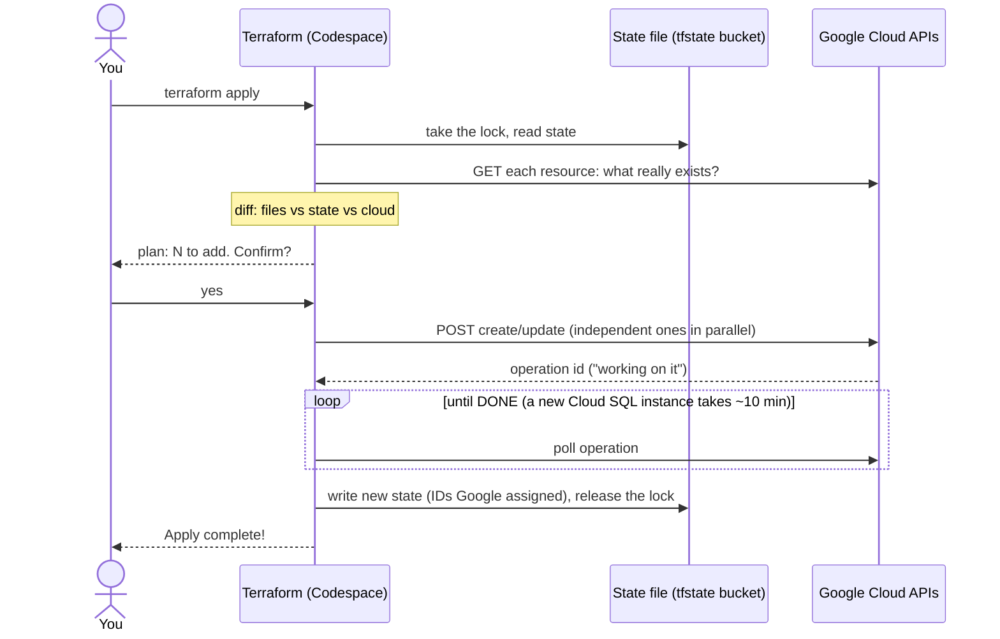
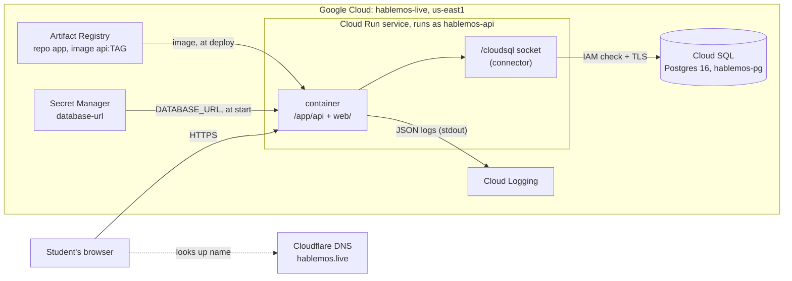

# How deployment works

The app runs in Google Cloud (project `hablemos-live`, region `us-east1`). Everything there
is described by the Terraform files in [`infra/`](../infra/), except the two things
[`infra/bootstrap.sh`](../infra/bootstrap.sh) creates first (two APIs and the state bucket).

## One `terraform apply`, call by call

Terraform runs in the Codespace and is just a client of Google's REST APIs, signed in as you
(`gcloud auth application-default login`). It never touches the app container.

`terraform plan` is the steps up to the plan only; it changes nothing. `docker push` follows the
same pattern with a different client: REST calls to Artifact Registry, signed in as you.

**Idempotent, not atomic.** Running `apply` again when nothing changed does nothing. But an
apply has no commit or rollback: if it fails halfway, what finished stays created and recorded,
and the next `apply` carries on from there. A single resource is mostly all-or-nothing, with
three exceptions:

- **Tainted**: Google created it but a follow-up step failed. The next plan proposes to replace it
  (deletion protection blocks that for the database, on purpose).
- **Orphaned**: Terraform was killed mid-apply, so Google finished creating something that never
  reached the state file. The next apply fails with "already exists"; fix with `terraform import`.
  So once an apply starts, let it finish (one Ctrl-C stops gracefully, a second one kills it).
- **Failed**: Google itself reports failure (e.g. a Cloud SQL instance in `FAILED`). Delete it and apply again.

The state lock (an object in the bucket) stops two applies from running at once.

## The running system

Once deployed, Terraform is out of the picture.

Until the domain is set up, the app is at a Google-made `…run.app` address.

### Following one request

1. The browser sends `GET /sessions` over HTTPS. Google terminates TLS, so the Go server
   speaks plain HTTP on `$PORT`, the same as in the Codespace.
2. If no copy of the container is running (nobody visited for a while), Cloud Run starts one
   and that first request waits a second or two: a **cold start**, the price of paying nothing
   while idle.
3. The container already has `DATABASE_URL` in its environment. Cloud Run read it from
   Secret Manager, which it may do because the service runs as `hablemos-api`.
4. pgx opens the Unix socket `/cloudsql/hablemos-live:us-east1:hablemos-pg`. The connector
   behind it checks the service account's `roles/cloudsql.client`, opens TLS to Cloud SQL and
   passes the Postgres protocol through. That's why the database needs no allowed networks.
5. The query runs, JSON goes back, and the request log line (with its request ID) lands in
   Cloud Logging.

## Every piece

| Piece | What it is | Closest IBM i idea | Defined in |
|---|---|---|---|
| State file | Terraform's record of what it created, with Google's IDs | A catalog the next run compares against | `gs://hablemos-live-tfstate` |
| Service APIs | Switches that let the project use a product | Licensing a product option | `infra/main.tf` |
| Artifact Registry | Private Docker image store, repository `app` | The library you deploy program objects from | `infra/main.tf` |
| Service account | `hablemos-api`, the identity the app runs as | The user profile a job runs under, with only its own authorities | `infra/main.tf` |
| Cloud SQL | A Google-managed VM running Postgres 16, daily backups | The database server, with Google applying fixes and taking saves | `infra/database.tf` |
| Secret | `database-url`: the full connection string, password included | A credential store only one profile can read | `infra/database.tf` |
| IAM grants | `cloudsql.client` and `secretAccessor` for the service account | Object authorities granted to that profile | `infra/database.tf` |
| Cloud Run service | Runs the container on demand behind an HTTPS URL | A subsystem that starts jobs when work arrives, ends them when idle | `infra/run.tf` |

The database password is generated by Terraform as an **ephemeral** value and sent only to
**write-only** arguments, so it is never stored in the state file. To rotate it, bump
`db_password_version` in `infra/database.tf` and apply.
