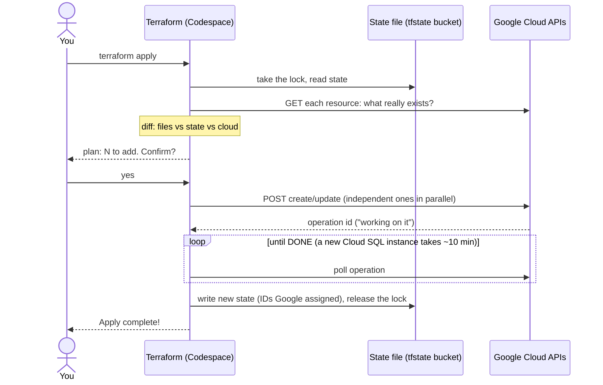
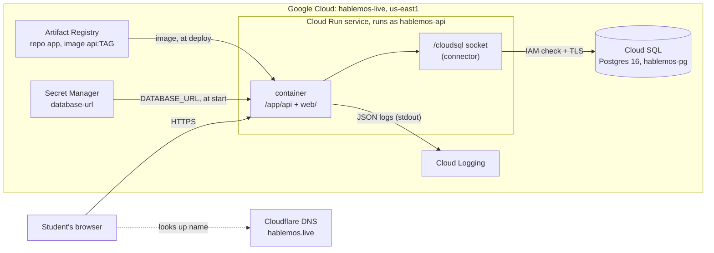
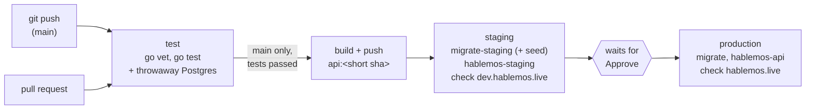
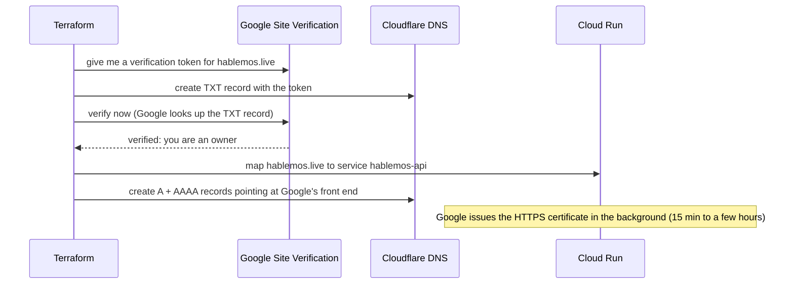
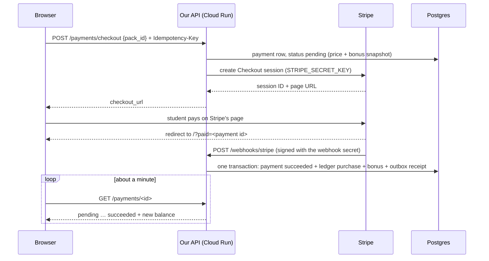
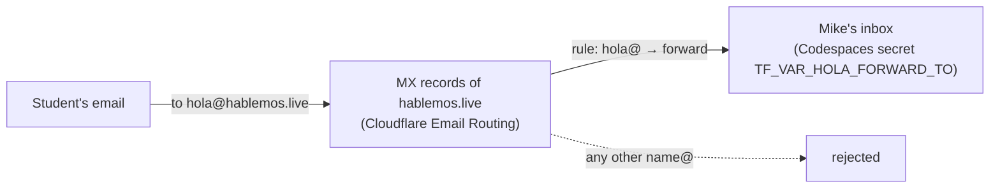
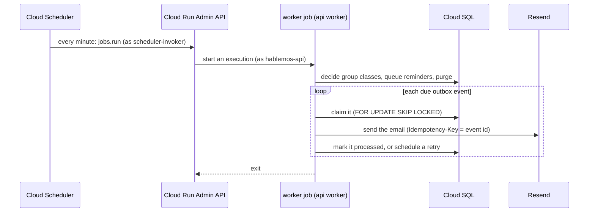
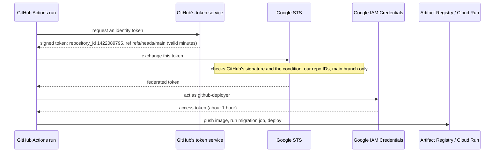
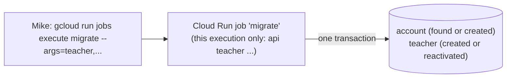
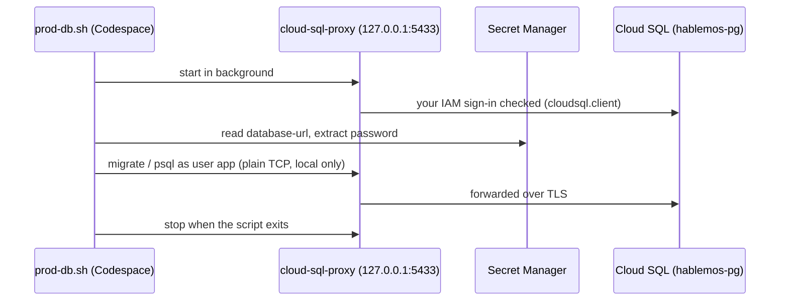

# How deployment works

The app runs in Google Cloud (project `hablemos-live`, region `us-east1`). Everything there
is described by the Terraform files in [`infra/`](../infra/), except the two things
[`infra/bootstrap.sh`](../infra/bootstrap.sh) creates first (two APIs and the state bucket).

## One `terraform apply`, call by call

Terraform runs in the Codespace and is just a client of Google's REST APIs, signed in as you
(`gcloud auth application-default login`). It never touches the app container.



`terraform plan` is the steps up to the plan only; it changes nothing. `docker push` follows the
same pattern with a different client: REST calls to Artifact Registry, signed in as you.

**Idempotent, not atomic.** Running `apply` again when nothing changed does nothing. But an
apply has no commit or rollback: if it fails halfway, what finished stays created and recorded,
and the next `apply` carries on from there. A single resource is mostly all-or-nothing, with
three exceptions:

- **Tainted**: Google created it but a follow-up step failed. The next plan proposes to replace it
  (deletion protection blocks that for the database, on purpose).
- **Orphaned**: Terraform was killed mid-apply, so Google finished creating something that never
  reached the state file. The next apply fails with "already exists"; fix with `terraform import`.
  So once an apply starts, let it finish (one Ctrl-C stops gracefully, a second one kills it).
- **Failed**: Google itself reports failure (e.g. a Cloud SQL instance in `FAILED`). Delete it and apply again.

The state lock (an object in the bucket) stops two applies from running at once.

## The running system

Once deployed, Terraform is out of the picture.



Until the domain is set up, the app is at a Google-made address. Cloud Run answers on two:
`https://hablemos-api-529979780991.us-east1.run.app` (the newer, predictable form:
service-projectnumber.region, used for `APP_BASE_URL` in `infra/run.tf`) and
`https://hablemos-api-bfox5zpazq-ue.a.run.app` (the older hashed form, which `terraform output
service_url` reports). Both reach the same service.

### Following one request

1. The browser sends `GET /sessions` over HTTPS. Google terminates TLS, so the Go server
   speaks plain HTTP on `$PORT`, the same as in the Codespace.
2. If no copy of the container is running (nobody visited for a while), Cloud Run starts one
   and that first request waits a second or two: a **cold start**, the price of paying nothing
   while idle.
3. The container already has `DATABASE_URL` in its environment. Cloud Run read it from
   Secret Manager, which it may do because the service runs as `hablemos-api`.
4. pgx opens the Unix socket `/cloudsql/hablemos-live:us-east1:hablemos-pg`. The connector
   behind it checks the service account's `roles/cloudsql.client`, opens TLS to Cloud SQL and
   passes the Postgres protocol through. That's why the database needs no allowed networks.
5. The query runs, JSON goes back, and the request log line (with its request ID) lands in
   Cloud Logging.

## Deploying a new version

**Push to `main`, try it on staging, approve.** [`.github/workflows/deploy.yml`](../.github/workflows/deploy.yml):



The image is built **once**; staging and production run the exact same image. Any failing step stops
the run, and the version already live keeps serving.

**Approving:** after staging is deployed, the run shows "Waiting for review" on the repository's
**Actions** tab (GitHub also emails the reviewer). Try the change on https://dev.hablemos.live, then
**Review deployments** > tick `production` > **Approve and deploy**. Reject (or just leave it) to keep
production as it is. If a newer push arrives while one waits, the newer run takes its place.

That last part shows up on the older run as a cancelled `deploy-prod` with the message *"Canceling
since a higher priority waiting request for deploy-prod exists"*. It is not a failure: GitHub keeps at
most one waiting job per concurrency group, so only the newest change is ever offered to production
(it contains all the earlier ones), and an old approval can never deploy older code over newer.
Production stays on the last version someone approved until the next approval. To see what's live:
`gcloud run services describe hablemos-api --region us-east1 --format='value(spec.template.spec.containers[0].image)'`.

The approval rule lives in GitHub, not in the workflow file: repository **Settings > Environments >
production > Required reviewers**. `staging` has no rule. `production` also only accepts deployments
from the `main` branch.

- **Order matters:** migrations run before the new code is deployed, in each environment. Keep
  migrations backward-compatible (add columns/tables; drop only in a later release), because the old
  revision keeps serving until the new one is ready.
- **Pull requests** run the tests only; they never get Google credentials.
- **One deploy per environment at a time** (`concurrency`).
- **Who owns the image:** the workflow. Terraform ignores image changes on the services and jobs
  (`lifecycle { ignore_changes }` in `infra/run.tf`), so `terraform apply` never rolls back a deploy.
  Terraform still owns everything else (env vars, scaling, secrets).
- **Which commit is live:** the image tag is the commit's short hash:
  `gcloud run services describe hablemos-api --region us-east1 --format='value(spec.template.spec.containers[0].image)'`
  (`hablemos-staging` for staging).

### Rolling back

Every deploy is a new **revision**, and old revisions stay around. To send traffic back to the
previous one at once (no build):

```bash
gcloud run revisions list --service hablemos-api --region us-east1 --limit 5
gcloud run services update-traffic hablemos-api --region us-east1 --to-revisions <REVISION_NAME>=100
```

`<REVISION_NAME>` is a placeholder: copy a name from the list, e.g. `hablemos-api-00003-vzp`.
That pins traffic to that revision; the next deploy from `main` sends traffic to its own new
revision again. Usually the better fix is `git revert` + push, which goes through tests.

### By hand (if GitHub Actions is down)

```bash
cd /workspaces/language-classes
git status                                   # commit first: the tag is the commit
IMAGE=us-east1-docker.pkg.dev/hablemos-live/app/api:$(git rev-parse --short HEAD)
docker build -t $IMAGE . && docker push $IMAGE
gcloud run jobs update migrate --image $IMAGE --region us-east1 --quiet
gcloud run jobs execute migrate --region us-east1 --wait
gcloud run services update hablemos-api --image $IMAGE --region us-east1 --quiet
curl -s https://hablemos.live/health; echo   # expect {"status":"ok"}
```

## Staging: https://dev.hablemos.live

A second, complete copy of the app for testing with fake money, so friends can try new features
before real students see them. It costs almost nothing extra: it shares the Cloud SQL instance and
Cloud Run scales it to zero when idle.

| | Production | Staging |
|---|---|---|
| Address | `https://hablemos.live` | `https://dev.hablemos.live` |
| Cloud Run service / migration job | `hablemos-api` / `migrate` | `hablemos-staging` / `migrate-staging` |
| Database / user on `hablemos-pg` | `app` / `app` | `staging` / `staging` |
| Secret with its DATABASE_URL | `database-url` | `database-url-staging` |
| Runs as (service account) | `hablemos-api` | `hablemos-staging` |
| `APP_ENV` | not set | `staging` |

In Terraform, each per-environment resource has `for_each = local.envs` (`infra/envs.tf`): one
definition, one copy per entry in that map. Adding an environment means adding an entry (and its
domain in `infra/domain.tf`). `infra/moved.tf` records the one-time rename of the production resources
to their `["prod"]` addresses, so that change moved state only and touched nothing in the cloud.

Isolation: each environment's service account can read only its own `database-url*` secret, so the
staging app never has production's password. In the database, tables belong to the user that ran
the migrations (`app` in production), and other users can't read them.

## Every piece

| Piece | What it is | Closest IBM i idea | Defined in |
|---|---|---|---|
| State file | Terraform's record of what it created, with Google's IDs | A catalog the next run compares against | `gs://hablemos-live-tfstate` |
| Service APIs | Switches that let the project use a product | Licensing a product option | `infra/main.tf` |
| Artifact Registry | Private Docker image store, repository `app` | The library you deploy program objects from | `infra/main.tf` |
| Service account | `hablemos-api`, the identity the app runs as | The user profile a job runs under, with only its own authorities | `infra/main.tf` |
| Cloud SQL | A Google-managed VM running Postgres 16, daily backups | The database server, with Google applying fixes and taking saves | `infra/database.tf` |
| Secret | `database-url`: the full connection string, password included | A credential store only one profile can read | `infra/database.tf` |
| IAM grants | `cloudsql.client` and `secretAccessor` for the service account | Object authorities granted to that profile | `infra/database.tf` |
| Cloud Run service | Runs the container on demand behind an HTTPS URL | A subsystem that starts jobs when work arrives, ends them when idle | `infra/run.tf` |

## Signing in (after a rebuild or when credentials expire)

```bash
gcloud auth login --no-launch-browser
gcloud auth application-default login --no-launch-browser --scopes=openid,https://www.googleapis.com/auth/userinfo.email,https://www.googleapis.com/auth/cloud-platform,https://www.googleapis.com/auth/sqlservice.login,https://www.googleapis.com/auth/siteverification
gcloud config set project hablemos-live
```

There are two logins because two kinds of program use them. The first is for the `gcloud`
command itself (and `docker push`). The second, "application-default credentials", is a file
other programs pick up: Terraform and the Cloud SQL Auth Proxy. Each prints a link; open it,
approve, and paste the code back.

The `--scopes` list is the default set plus `siteverification`. Proving domain ownership is a
separate Google API from Cloud management, and `infra/domain.tf` uses it. Check with
`cd infra && terraform plan`: it should say "no differences".

## The domain: hablemos.live

`infra/domain.tf` connects three parties:



DNS records are **DNS only** (grey cloud): browsers look the name up at Cloudflare, then connect
straight to Google.

`www.hablemos.live` has its own domain mapping (so Google accepts it and issues it a certificate)
and a CNAME to `ghs.googlehosted.com`. The app answers any `www.` request with a **308** redirect
to the bare domain, same path and query (`redirectWWW` in `cmd/api/main.go`). Doing it in the app
avoids needing Cloudflare's proxy or a Google load balancer just for a redirect. Check progress with
`gcloud beta run domain-mappings describe --domain hablemos.live --region us-east1`
(the `CertificateProvisioned` condition turns `True` when HTTPS is ready).

## Email: sending login links (Resend)

Login links are sent through [Resend](https://resend.com) (account owner: Mike). For Gmail, Outlook
and others to accept mail "from" `hablemos.live`, `infra/email.tf` publishes the records Resend
asks for (Resend dashboard: Domains > hablemos.live > Records):

| Record | Type | Purpose |
|---|---|---|
| `resend._domainkey` | TXT | **DKIM** public key. Resend signs each message with the private half; receivers verify it, so forged or altered mail fails. |
| `send`, `rsend` | CNAME → `*.forge.rmta.net` | Delegates the sending subdomains to Resend, which publishes **SPF** and bounce handling there and can change them without our DNS changing. |
| `_dmarc` | TXT | **DMARC** policy for failed checks. `p=none` (report only) for now; tighten to `quarantine` once mail flows cleanly. |

All values are public. Never use Resend's "Auto configure" button: it would create records
outside Terraform. The domain is verified in Resend (Verify button) after the records exist.

### The API key

The app authenticates to Resend with an API key kept in Secret Manager as `resend-api-key`.
Terraform creates the (empty) secret and lets `hablemos-api` read it; the value is added by hand,
so it never appears in a file, git, or Terraform state.

In Resend: **API Keys > Create API Key**, permission **Sending access**, domain **hablemos.live**
(a key that can only send, only from our domain). Copy it, then:

```bash
read -rsp "Paste the Resend API key, then press Enter: " RESEND_KEY; echo
printf '%s' "$RESEND_KEY" | gcloud secrets versions add resend-api-key --data-file=-
unset RESEND_KEY
```

`read -s` doesn't echo what you paste and keeps it out of the shell history; `printf '%s'` adds no
trailing newline; `--data-file=-` reads the value from the pipe. **To rotate:** create a new key in
Resend, run the same three lines (a new secret version), redeploy (Cloud Run reads secrets when an
instance starts), then delete the old key in Resend.

## Payments: buying credit (Stripe Checkout)

Students buy credit packs; Mike's Stripe account receives the money (the teacher is paid outside the
app). Card details never touch our server: the student pays on Stripe's own page.



Only the webhook adds credit. The browser's part (the redirect, the polling) only updates the screen:
if the student closes the tab after paying, the credit still arrives. Stripe retries a webhook that
doesn't get a 2xx answer for up to 3 days, and our handler is idempotent (a repeat finds the
payment already succeeded and does nothing).

### The secrets

Each environment has its own two secrets (`infra/stripe.tf`); Terraform creates them empty and lets
only that environment's service account read them. The values are added by hand, like the Resend key.

| Secret | What it is | Staging | Production |
|---|---|---|---|
| `stripe-secret-key[-staging]` | API key our server calls Stripe with | sandbox key (`…_test_…`), Custom permissions | live key (`…_live_…`), Custom permissions |
| `stripe-webhook-secret[-staging]` | signing secret Stripe signs webhook calls with | `whsec_…` of the sandbox endpoint | `whsec_…` of the live endpoint |

An environment uses them once `payments = true` in `infra/envs.tf` (Cloud Run won't start a revision
that points at an empty secret, so the values must exist first). Until then `GET /env` says
`"payments": false` and the page hides Buy credit.

### Setting up an environment (staging shown)

In the Stripe dashboard, make sure you're in the **sandbox** (account menu, top left) for staging,
or the live account for production. Stripe's menus move around; the names to look for are below.

**1. A key that can only create Checkout pages** (like the Resend key can only send). Stripe no
longer has a separate "restricted keys" list: every secret key has its own permissions.
Developers > **API keys** > **Create secret key** > (for your own integration) > **Custom permissions**
(not a template, not either "Full access"). Name it `hablemos-staging-checkout` (production:
`hablemos-prod-checkout`), set **Checkout Sessions** to **Write**, leave everything else at None,
**Access policy: None** (an IP allow-list would block Cloud Run, which has no fixed outgoing address).
Create it and copy it right away (shown once). On the API keys list its Permissions column must not say
"Full access". Leave the account's default Full-access key alone; we don't use it. Then, in the Codespace:

```bash
read -rsp "Paste the Stripe key, then press Enter: " V; echo
printf '%s' "$V" | gcloud secrets versions add stripe-secret-key-staging --data-file=-
unset V
```

Expected output: `Created version [1] of the secret [stripe-secret-key-staging].` (same `read -s` /
`printf` pattern as the Resend key: nothing is echoed, nothing lands in the shell history.)

**2. The webhook endpoint**: Developers > **Webhooks** > **Create an event destination**:

- Scope **Your account** (not Connected accounts: we're not a platform for other businesses).
- Payload style **Snapshot** (the event carries the whole Checkout session, which our handler reads;
  "Thin" would send only an ID, and our key has no permission to fetch the rest). API version: the default.
- Events (search "checkout"): tick all four, `checkout.session.completed`,
  `checkout.session.async_payment_succeeded`, `checkout.session.async_payment_failed`,
  `checkout.session.expired` (Selected events: 4).
- Destination type **Webhook endpoint**. Name `hablemos-staging` (production: `hablemos-prod`).
- Endpoint URL: `https://dev.hablemos.live/webhooks/stripe` (production: `https://hablemos.live/webhooks/stripe`).

Open the new endpoint, reveal its **Signing secret** (`whsec_…`) and copy it:

```bash
read -rsp "Paste the webhook signing secret (whsec_...), then press Enter: " V; echo
printf '%s' "$V" | gcloud secrets versions add stripe-webhook-secret-staging --data-file=-
unset V
```

**3. Check you didn't swap or mix them up** (prints only the first 8 characters):

```bash
for s in stripe-secret-key-staging stripe-webhook-secret-staging; do
  echo "$s: $(gcloud secrets versions access latest --secret=$s | cut -c1-8)…"
done
```

Expected for staging: a key with `_test_` in it (`rk_test_` or `sk_test_`) and `whsec_…`. On production
the key must have `_live_`. No backup copies elsewhere: Secret Manager keeps the versions, and a
doubtful key is replaced with a new one (rotate, below), not recovered.

**4. Turn it on**: set `payments = true` for the environment in `infra/envs.tf`, commit, and
`cd infra && terraform apply` (expected: the service updated in place, a new revision with the two
`STRIPE_*` variables). `curl -s https://dev.hablemos.live/env` should then show `"payments":true`.

**To rotate** a key: create a new restricted key, add it as a new version (step 1), redeploy (Cloud Run
reads secrets when an instance starts), then delete the old key in Stripe. **If Stripe refuses** a
checkout ("does not have the required permissions"), the error in our logs (`checkout: Stripe refused`)
names the missing permission; add it to the restricted key.

## Receiving email: hola@hablemos.live (Cloudflare Email Routing)

Resend only sends. For students to write to us (questions, refunds of unused credit), mail to
`hola@hablemos.live` is **forwarded** by Cloudflare Email Routing to Mike's own inbox (`infra/inbox.tf`):



- Cloudflare adds and manages the MX and SPF records on the bare domain. Resend's records are on the
  `send.` subdomain, so sending and receiving don't touch.
- There's no mailbox to check: mail lands in Mike's normal inbox. Replies Mike sends come from his own
  address. A second person handling mail later would mean a real mailbox (Google Workspace, Zoho); the
  `hola@` address stays the same.
- The destination is personal, so it isn't in the repo. It's the Codespaces secret
  `TF_VAR_HOLA_FORWARD_TO`; Terraform reads any `TF_VAR_<name>` environment variable as the input
  variable `<name>`. It is stored in Terraform's state (the private state bucket).
- **Names are case-sensitive in Terraform but not in GitHub:** GitHub stores secret names in UPPER CASE
  whatever you type, so the Terraform variable is named `HOLA_FORWARD_TO` (capitals) to match. If
  `terraform plan` ever stops to ask for a variable, the secret isn't reaching it: check the names with
  `env | cut -d= -f1 | grep TF_VAR` (prints names, never values).

### Setting it up (once)

**1. The secret.** GitHub → your profile picture → **Settings → Codespaces → Secrets → New secret**.
Name `TF_VAR_HOLA_FORWARD_TO`, value: the inbox to forward to, repository access: `msf143/language-classes`.
Codespaces inject secrets when a codespace starts, so **stop and restart the codespace** (Command Palette:
"Codespaces: Stop Current Codespace", then reopen it). Check without printing it:

```bash
test -n "$TF_VAR_HOLA_FORWARD_TO" && echo "set" || echo "NOT set"
```

**2. The Cloudflare token's permissions.** The token Terraform uses (`CLOUDFLARE_API_TOKEN`) could only edit
DNS. Cloudflare dashboard → **My Profile → API Tokens** → the token → **Edit**, and add:

| Scope | Permission | Why |
|---|---|---|
| Account | **Email Routing Addresses: Edit** | the destination address (kept per account) |
| Zone | **Email Routing Rules: Edit** | the `hola@` rule |
| Zone | **Zone Settings: Edit** | turning Email Routing on (`POST /zones/…/email/routing/dns` accepts only "Zone Settings Write") |

For the Account permission, also set **Account Resources** to include your account. Keep the zone limited to
`hablemos.live`. Save; the token's value doesn't change, so the Codespaces secret stays as it is. (The token is
the one named "Edit zone DNS", after the template it was made from.) If `apply` answers `403`/`Authentication
error`, the error names the refused API call; Cloudflare's API docs for that call list the permission it accepts.

"Zone Settings: Edit" is broad (it could also change SSL or caching on this zone). Turning routing on is a
one-time action, so after it's applied the row can be lowered to **Read**, which `plan` needs; raise it again
only to turn routing off or on.

**3. Apply.** If a lock error appears (`Error acquiring the state lock`, `Error 412`), another run holds
the state, or a cancelled one left its lock behind. Check the lock's **Who** and **Created**, make sure no
`terraform` process is still running (`ps -eo pid,args | grep [t]erraform`; `terraform-ls` is only the editor's
language server), then `terraform force-unlock <ID from the message>`.

```bash
cd /workspaces/language-classes/infra && terraform apply
```

Expected: `3 to add` (`cloudflare_email_routing_dns.main`, `cloudflare_email_routing_address.mike`,
`cloudflare_email_routing_rule.hola`); the address shows as `(sensitive value)`.

**4. Verify the destination.** Cloudflare emails the destination inbox ("Verify your email address"). Click
the link. Until then nothing is forwarded.

**5. Check.**

```bash
dig +short MX hablemos.live
```

Expected: three `route1/2/3.mx.cloudflare.net` lines. Then send a test from a **different** address than the
destination (some providers hide a forwarded copy of your own mail) to `hola@hablemos.live`; it should arrive
within a minute.

## The worker: emails and timed checks

Every minute, **Cloud Scheduler** starts the Cloud Run job `worker` (`worker-staging` for staging),
which runs `api worker` (`infra/worker.tf`, `cmd/api/worker.go`). Each run:

1. **Decides group classes** starting within 24 hours that are still undecided: at least `min_seats`
   booked → `confirmed`; fewer → cancelled (`under_minimum`) with a full refund for every booking.
2. **Queues reminders**: one per booking, 24 hours before the class (not for bookings made within 24 hours).
3. **Purges** login links expired over a day ago and sign-in sessions expired over a week ago.
4. **Drains the outbox**: every booking, cancellation and reminder event becomes an email (English and
   Spanish, times in the recipient's zone). Up to 50 seconds per run, then it exits.



**Delivery is at-least-once, but emails go out once.** If a run crashes after sending and before marking
the event processed, the next run sends again, and Resend drops the repeat because it carries the same
`Idempotency-Key`. Failed sends are retried after 1, 2, 4 … minutes (at most an hour apart), up to 10
times; events older than 48 hours are skipped (`last_error = 'skipped: stale'`). Several runs at once are
safe: `SKIP LOCKED` gives each one different events.

Useful commands:

```bash
gcloud run jobs executions list --job worker --region us-east1 --limit 5          # recent runs
gcloud logging read 'resource.type="cloud_run_job" AND resource.labels.job_name="worker" AND jsonPayload.msg="worker run done"' --limit 5 --format='value(timestamp,jsonPayload.processed,jsonPayload.failed,jsonPayload.skipped)'
gcloud scheduler jobs pause worker-every-minute --location us-east1                 # stop the worker
gcloud scheduler jobs resume worker-every-minute --location us-east1                # start it again
```

Stuck or failing events (in a SQL shell on that environment's database):

```sql
SELECT event_type, attempts, last_error, available_at FROM outbox_event
WHERE processed_at IS NULL AND attempts > 0 ORDER BY created_at;
```

## GitHub Actions: deploying without a stored key

`infra/github.tf` sets up **Workload Identity Federation**: Google trusts identity tokens that
GitHub signs for each workflow run, so no Google key is stored in GitHub.



The **condition** on the provider only accepts tokens whose claims match our repository's
numeric ID, its owner's numeric ID, and `refs/heads/main`. IDs, not names: if the repo were
ever deleted or renamed, someone else could create one with the same name but never with the
same IDs. Pull requests and other branches can run tests but never get Google credentials.

`github-deployer` may only push images to repository `app`, deploy Cloud Run revisions and run
jobs (`roles/run.developer`), and act as `hablemos-api` (needed to deploy a revision that runs as
it). It cannot touch IAM, the database instance, DNS, or Terraform state.

## Making someone a teacher

No web page can make anyone a teacher. Our binary has a command for it, `api teacher`, and on Cloud Run it
runs as a **one-off execution of the migration job** with different arguments: the job already has the
image, the database connection and the right service account, so nothing new is needed, and only people
with Google Cloud permissions can run it.



What it does, in one transaction: finds the account by email (any capitals) or creates it; optionally sets
the display name and time zone; creates the teacher row (private lengths 30/45/60) or makes an existing one
active again. Running it twice changes nothing more.

**Try it on staging first** (job `migrate-staging`), then production (job `migrate`). Replace the
placeholders `TEACHER_EMAIL` and `TEACHER NAME` (no commas in the name: `--args` is comma-separated):

```bash
gcloud run jobs execute migrate --region=us-east1 --wait \
  --args="teacher,-email,TEACHER_EMAIL,-name,TEACHER NAME,-timezone,America/Bogota"
```

`--args` replaces the job's usual arguments (`migrate`) for **this execution only**; the job itself is
unchanged. `--wait` waits until it finishes. Expected: `Execution [migrate-xxxxx] has successfully
completed.` Then the result line from the logs:

```bash
gcloud logging read 'resource.type="cloud_run_job" AND resource.labels.job_name="migrate" AND jsonPayload.msg=~"teacher"' \
  --freshness=10m --limit=1 --format='value(jsonPayload.msg, jsonPayload.email, jsonPayload.new_account, jsonPayload.new_teacher)'
```

Expected: `teacher ready  <email>  True  True` the first time (`False False` if they already were one). The
teacher then signs in with that email (a login link, like everyone) and sees the "Teacher page" link.

Locally: `go run ./cmd/api teacher -email TEACHER_EMAIL -name "TEACHER NAME" -timezone America/Bogota`.

## Running migrations on prod

Prod migrations run in the cloud as the Cloud Run **job** `migrate` (`infra/run.tf`): the app's own
image started as `api migrate` (`cmd/api/migrate.go`). The migration files are compiled into the
binary (`migrations/embed.go`), so the image always carries exactly the migrations its code expects.

```bash
gcloud run jobs execute migrate --region us-east1 --wait   # deploys run this first
gcloud run jobs executions list --job migrate --region us-east1 --limit 5
```

How `api migrate` works:
1. Takes a Postgres **advisory lock**, so two runs (two quick deploys) can't overlap.
2. Reads the version from `schema_migrations`, the same one-row table the `migrate` CLI uses in dev.
3. Applies each newer `*.up.sql` file in order, **each in one transaction together with its
   version bump**. Postgres DDL is transactional, so a failing migration rolls back completely and
   the version stays put; fix the file and run again. (Hence the rule: no statements that can't run
   in a transaction, like `CREATE INDEX CONCURRENTLY`.)
4. Logs `migration applied` per file and `migrations done` with the final version, to Cloud Logging.

It only goes up; down migrations are a dev tool. The job has `max_retries = 0`: a failed migration
needs a person, and the deploy stops there, so the old code keeps serving the old schema.

### By hand from the Codespace

[`scripts/prod-db.sh`](../scripts/prod-db.sh) is still there for a SQL shell on prod, or for
running the `migrate` CLI directly (`version`, or `force` after a dirty dev-style failure).

```bash
scripts/prod-db.sh migrate version   # where prod is
scripts/prod-db.sh migrate up        # apply new migrations
scripts/prod-db.sh psql              # SQL shell on prod (careful)
```

Prerequisites: signed in with `gcloud auth login` and `gcloud auth application-default login`
(the proxy uses the second), as an account with `roles/cloudsql.client` and access to the
`database-url` secret. The project owner has both.



Migrations run as the `app` user, the same user the app connects as, so tables are owned by it.
Seed data (`scripts/seed.sql`) is for dev only; don't load it on prod.

## The database password

The database password is generated by Terraform as an **ephemeral** value and sent only to
**write-only** arguments, so it is never stored in the state file. To rotate it, bump
`db_password_version` in `infra/database.tf` and apply.
